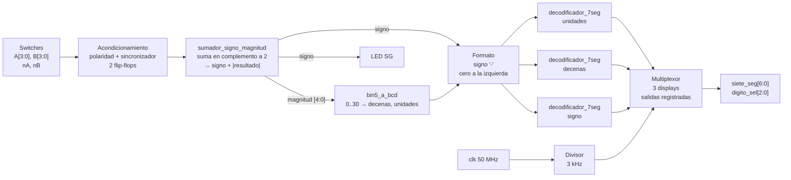

# Sumador con signo y visualización en 7 segmentos (FPGA Cyclone IV)

Sistema digital en **Verilog** que suma dos números de 4 bits **con signo seleccionable** y muestra el resultado en **tres displays de 7 segmentos multiplexados** (signo, decenas y unidades).

Hace las cuatro operaciones:

| `nA` | `nB` | Operación | Ejemplo (A=7, B=12) | Display |
|:---:|:---:|:---:|:---:|:---:|
| 0 | 0 | A + B   | 7 + 12   | ` 19` |
| 1 | 0 | −A + B  | −7 + 12  | ` 05` |
| 0 | 1 | A − B   | 7 − 12   | `-05` |
| 1 | 1 | −A − B  | −7 − 12  | `-19` |

- **Rango de operandos:** 0 a 15 (4 bits sin signo cada uno).
- **Rango del resultado:** −30 a +30.
- **Plataforma objetivo:** FPGA Intel/Altera **Cyclone IV EP4CE10E22C8**, reloj de 50 MHz, displays de **ánodo común**.

---

## Contenido del repositorio

| Archivo | Descripción |
|---|---|
| `top_sistema_visualizacion.v` | Diseño completo (módulo top y submódulos). |
| `tb_top_sistema_visualizacion.v` | Banco de pruebas exhaustivo (1024 casos). |
| `README.md` | Este documento. |

---

## Arquitectura general



El flujo de datos es **combinacional** desde las entradas sincronizadas hasta los decodificadores. Solo tres partes trabajan con el reloj:

1. el sincronizador de entradas,
2. el divisor de frecuencia del multiplexado,
3. los registros de salida.

---

## Interfaz del módulo top

```verilog
module top_sistema_visualizacion #(
    parameter CLK_HZ                = 50_000_000,
    parameter CAMBIO_HZ             = 3_000,
    parameter ENTRADAS_ACTIVAS_BAJO = 1,
    parameter SEG_ACTIVOS_BAJO      = 1,
    parameter DIG_ACTIVOS_BAJO      = 1,
    parameter APAGAR_CERO_IZQ       = 0
)(
    input  wire       clk,
    input  wire       A0, A1, A2, A3,
    input  wire       B0, B1, B2, B3,
    input  wire       nA, nB,
    output reg  [6:0] siete_seg,
    output reg  [2:0] digito_sel,
    output reg        SG
);
```

### Puertos

| Puerto | Dirección | Ancho | Función |
|---|:---:|:---:|---|
| `clk` | entrada | 1 | Reloj de la placa (50 MHz). |
| `A0`–`A3` | entrada | 4 × 1 | Operando A (A0 = bit menos significativo). |
| `B0`–`B3` | entrada | 4 × 1 | Operando B (B0 = bit menos significativo). |
| `nA` | entrada | 1 | `1` = A se toma como negativo (−A). |
| `nB` | entrada | 1 | `1` = B se toma como negativo (−B). |
| `siete_seg` | salida | 7 | Segmentos compartidos `{g,f,e,d,c,b,a}`. |
| `digito_sel` | salida | 3 | `[0]` unidades, `[1]` decenas, `[2]` signo. |
| `SG` | salida | 1 | LED indicador: `1` = resultado negativo. |

Los valores lógicos de la tabla (`1` = activo) son los que ve el diseño **por dentro**, ya con la polaridad corregida (ver la sección de parámetros).

### Parámetros

| Parámetro | Por defecto | Descripción |
|---|:---:|---|
| `CLK_HZ` | `50_000_000` | Frecuencia del reloj de la placa en Hz. |
| `CAMBIO_HZ` | `3_000` | Cambios de display por segundo. Con 3 displays, cada uno se refresca a 1 kHz. |
| `ENTRADAS_ACTIVAS_BAJO` | `1` | `1` si los switches/botones entregan `0` cuando están activados (resistencias pull-up). Invierte las 10 entradas. |
| `SEG_ACTIVOS_BAJO` | `1` | `1` para displays de **ánodo común** (el segmento enciende con `0`). Usar `0` para cátodo común. |
| `DIG_ACTIVOS_BAJO` | `1` | `1` si el display se habilita con `0` (típico con transistores PNP). |
| `APAGAR_CERO_IZQ` | `0` | `1` para apagar el cero a la izquierda: muestra ` -7` en vez de `-07`. |

Al cambiar estos parámetros, el diseño se adapta a otra placa sin tocar la lógica.

---

## Funcionamiento detallado

### 1. Acondicionamiento de entradas

```verilog
wire [9:0] entrada_pin = {nB, nA, B3, B2, B1, B0, A3, A2, A1, A0};
wire [9:0] entrada_log = ENTRADAS_ACTIVAS_BAJO ? ~entrada_pin : entrada_pin;

always @(posedge clk) begin
    sinc_1 <= entrada_log;
    sinc_2 <= sinc_1;
end
```

**Corrección de polaridad.** En muchas placas, los switches y botones tienen resistencias *pull-up*. Con el switch en reposo, el pin lee `1`. Sin invertir las entradas, todos los switches en "bajo" llegan como A = 1111 y B = 1111, y el sistema muestra **30** (15 + 15). Con `ENTRADAS_ACTIVAS_BAJO = 1`, las 10 entradas se invierten y el valor lógico coincide con la posición del switch.

**Sincronizador de 2 flip-flops.** Los switches no están sincronizados con el reloj de la FPGA. Si una entrada cambia justo en el flanco de reloj, el primer flip-flop puede quedar en un estado **metaestable**. El segundo flip-flop le da un ciclo completo (20 ns) para estabilizarse antes de que el valor llegue a la lógica. Es la práctica estándar para toda señal asíncrona que entra a un diseño síncrono.

### 2. Sumador con signo → signo-magnitud (`sumador_signo_magnitud`)

```verilog
wire signed [5:0] opA  = negA ? -$signed({2'b00, A}) : $signed({2'b00, A});
wire signed [5:0] opB  = negB ? -$signed({2'b00, B}) : $signed({2'b00, B});
wire signed [5:0] suma = opA + opB;

assign signo    = suma[5];
wire [5:0] absoluto = signo ? -suma : suma;
assign magnitud = absoluto[4:0];
```

**Por qué 6 bits.** Cada operando va de −15 a +15 y el resultado de −30 a +30. En complemento a 2, 6 bits cubren de −32 a +31, así que **la suma nunca desborda**.

**Paso a paso:**

1. **Extensión:** `{2'b00, A}` convierte A (4 bits sin signo) en un número de 6 bits positivo.
2. **Negación opcional:** si `negA = 1`, se aplica `-` (complemento a 2: invertir los bits y sumar 1).
3. **Suma:** una sola suma de 6 bits resuelve las cuatro operaciones.
4. **Signo:** el bit más significativo (`suma[5]`) vale `1` si el resultado es negativo.
5. **Magnitud:** si el resultado es negativo se vuelve a negar para obtener el valor absoluto (0 a 30, que cabe en 5 bits).

**Ejemplo: A − B con A = 7, B = 12**

```
opA  =  7  = 000111
opB  = -12 = 110100   (001100 → invertir 110011 → +1 = 110100)
suma =       111011   = -5   → signo = 1
|suma|     = 000101   =  5   → magnitud = 5
```

**Detalle importante.** Un diseño que decide el signo con el **acarreo de salida** del sumador falla cuando el operando negado vale 0. El complemento a 2 de 0 es 0, pero ese acarreo se pierde, y −0 + 3 termina mostrándose como −13. Este diseño toma el signo del propio resultado en complemento a 2, así que funciona en todos los casos. Además, el cero **nunca** aparece como negativo.

### 3. Conversor binario → BCD (`bin5_a_bcd`)

```verilog
if      (bin >= 30) begin decenas = 3; unidades = bin - 30; end
else if (bin >= 20) begin decenas = 2; unidades = bin - 20; end
else if (bin >= 10) begin decenas = 1; unidades = bin - 10; end
else                begin decenas = 0; unidades = bin;      end
```

La magnitud máxima es 30, así que las decenas solo pueden valer de 0 a 3. Bastan tres comparaciones con constantes y una resta. La herramienta de síntesis lo convierte en lógica combinacional pequeña. Para un rango tan corto no hace falta un algoritmo general como *double dabble*.

| Magnitud | Decenas | Unidades |
|:---:|:---:|:---:|
| 0 – 9 | 0 | 0 – 9 |
| 10 – 19 | 1 | 0 – 9 |
| 20 – 29 | 2 | 0 – 9 |
| 30 | 3 | 0 |

### 4. Formato del display de signo y del cero a la izquierda

```verilog
wire cero_izq    = APAGAR_CERO_IZQ && (decenas == 0);
wire [3:0] sim_decenas = !cero_izq ? decenas : (signo ? MENOS : APAGADO);
wire [3:0] sim_signo   = (signo && !cero_izq) ? MENOS : APAGADO;
```

| Resultado | `APAGAR_CERO_IZQ = 0` | `APAGAR_CERO_IZQ = 1` |
|:---:|:---:|:---:|
| −30 | `-30` | `-30` |
| −5 | `-05` | ` -5` |
| +12 | ` 12` | ` 12` |
| 0 | ` 00` | `  0` |

Cuando el cero a la izquierda se apaga, el signo `-` se corre al display de las decenas para quedar pegado al número.

### 5. Decodificador de 7 segmentos (`decodificador_7seg`)

Traduce un símbolo de 4 bits a los 7 segmentos, en **lógica activa en alto** (`1` = segmento encendido). La polaridad física se aplica después, en un solo lugar.

```
     a
   ─────
  │     │
 f│     │b
  │  g  │
   ─────
  │     │
 e│     │c
  │     │
   ─────
     d
```

| Símbolo | `gfedcba` | | Símbolo | `gfedcba` |
|:---:|:---:|---|:---:|:---:|
| 0 | `0111111` | | 6 | `1111101` |
| 1 | `0000110` | | 7 | `0000111` |
| 2 | `1011011` | | 8 | `1111111` |
| 3 | `1001111` | | 9 | `1101111` |
| 4 | `1100110` | | `A` → `-` | `1000000` |
| 5 | `1101101` | | `F` → apagado | `0000000` |

Se usan tres instancias del mismo decodificador: una para las unidades, otra para las decenas y otra para el signo.

### 6. Multiplexado de los displays

Los tres displays comparten los 7 pines de segmentos. Solo uno se enciende a la vez y se alternan tan rápido que el ojo los percibe encendidos todos al mismo tiempo (persistencia de la visión).

```verilog
localparam DIV = CLK_HZ / CAMBIO_HZ;   // 50 MHz / 3 kHz ≈ 16 667 ciclos

always @(posedge clk)
    if (contador == DIV - 1) begin
        contador <= 0;
        sel <= (sel == 2) ? 0 : sel + 1;   // 0 → 1 → 2 → 0 ...
    end else
        contador <= contador + 1;
```

| `sel` | Display activo | `digito_sel` (lógico) | Segmentos enviados |
|:---:|---|:---:|---|
| 0 | Unidades | `001` | `seg_unidades` |
| 1 | Decenas | `010` | `seg_decenas` |
| 2 | Signo | `100` | `seg_signo` |

**Tiempos con un reloj de 50 MHz:**

- cada display permanece encendido unos **0,33 ms**,
- el ciclo completo de los 3 displays dura **1 ms**, es decir, **1 kHz de refresco**. Muy por encima de los ~60 Hz a partir de los cuales el ojo deja de notar el parpadeo.

**Salidas registradas.** `siete_seg`, `digito_sel` y `SG` se actualizan en el flanco del reloj:

```verilog
always @(posedge clk) begin
    siete_seg  <= SEG_ACTIVOS_BAJO ? ~seg_act : seg_act;
    digito_sel <= DIG_ACTIVOS_BAJO ? ~dig_act : dig_act;
    SG         <= signo;
end
```

Así los segmentos y la selección de display cambian en el mismo instante, y se evitan los *glitches* (destellos breves de un dígito en el display equivocado) que puede producir una salida combinacional.

---

## Uso en Quartus

1. Crear un proyecto para el dispositivo **EP4CE10E22C8** y agregar `top_sistema_visualizacion.v`.
2. Establecerlo como entidad de nivel superior (*Set as Top-Level Entity*).
3. Ejecutar *Analysis & Synthesis*.
4. En **Pin Planner**, asignar los pines según el esquemático de tu placa:
   - `clk` al oscilador de 50 MHz,
   - `A0`–`A3`, `B0`–`B3`, `nA`, `nB` a los switches,
   - `siete_seg[0]`…`siete_seg[6]` a los segmentos **a…g** (en ese orden),
   - `digito_sel[0]` al display de **unidades** (derecha), `digito_sel[1]` al de **decenas** y `digito_sel[2]` al de **signo** (izquierda),
   - `SG` a un LED (opcional).
5. Compilar y programar la FPGA.

Si tu placa usa otra polaridad (cátodo común, switches sin pull-up, etc.), cambia el parámetro que corresponda en lugar de editar la lógica.

---

## Simulación

El banco de pruebas recorre **las 1024 combinaciones** (16 valores de A × 16 de B × 4 modos de signo). Lee los tres displays igual que en la placa, traduciendo los patrones de segmentos a caracteres, y compara con el resultado esperado.

Con [Icarus Verilog](https://steveicarus.github.io/iverilog/):

```bash
# Modo por defecto (cero a la izquierda visible)
iverilog -g2012 -o sim tb_top_sistema_visualizacion.v top_sistema_visualizacion.v
vvp sim

# Modo con cero a la izquierda apagado
iverilog -g2012 -Ptb.Z=1 -o sim tb_top_sistema_visualizacion.v top_sistema_visualizacion.v
vvp sim
```

Salida esperada:

```
APAGAR_CERO_IZQ=0 -> 0 fallas de 1024 casos
APAGAR_CERO_IZQ=1 -> 0 fallas de 1024 casos
```

El banco de pruebas usa un reloj reducido (`CLK_HZ = 1500`) para que la simulación termine en segundos. La lógica es la misma que corre en la placa a 50 MHz.

---

## Solución de problemas

| Síntoma | Causa probable | Solución |
|---|---|---|
| Con todos los switches en bajo se ve `30` o `-30` | Entradas activas en bajo leídas sin invertir. | `ENTRADAS_ACTIVAS_BAJO = 1` (o `0` si tus switches no tienen pull-up). |
| Los segmentos encendidos y apagados están al revés | Polaridad del display incorrecta. | Cambiar `SEG_ACTIVOS_BAJO`. |
| Se ilumina el display equivocado o todos a la vez | Polaridad de selección incorrecta. | Cambiar `DIG_ACTIVOS_BAJO`. |
| Los dígitos salen en un orden distinto | Pines de `digito_sel` cruzados. | Revisar la asignación en Pin Planner. |
| Los números se ven deformes | Orden de los segmentos `a…g` cruzado. | `siete_seg[0]` = a, …, `siete_seg[6]` = g. |
| Los displays parpadean | Refresco demasiado bajo. | Aumentar `CAMBIO_HZ` o verificar `CLK_HZ`. |

---

## Estructura de módulos

```
top_sistema_visualizacion
├── sumador_signo_magnitud   (u_alu)      Suma con signo → signo + magnitud
├── bin5_a_bcd               (u_bcd)      Binario 0..30 → decenas + unidades
├── decodificador_7seg       (u_dec_uni)  Unidades → 7 segmentos
├── decodificador_7seg       (u_dec_dec)  Decenas  → 7 segmentos
└── decodificador_7seg       (u_dec_sig)  Signo    → 7 segmentos
```

