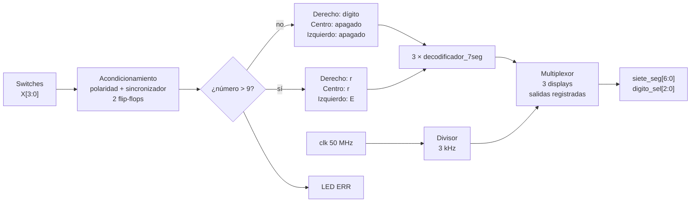

# Visualizador binario a 7 segmentos con detección de error (FPGA Cyclone IV)

Sistema digital en **Verilog** que lee un número binario de **4 bits** desde switches y lo muestra en decimal en un **display de 7 segmentos**. Si el número es mayor a 9 (no es un dígito decimal válido), los tres displays muestran el mensaje **`Err`**.

| Entrada (X3 X2 X1 X0) | Decimal | Display | LED `ERR` |
|:---:|:---:|:---:|:---:|
| `0000` | 0 | `  0` | apagado |
| `0101` | 5 | `  5` | apagado |
| `1001` | 9 | `  9` | apagado |
| `1010` | 10 | `Err` | encendido |
| `1111` | 15 | `Err` | encendido |

- **Plataforma objetivo:** FPGA Intel/Altera **Cyclone IV EP4CE10E22C8**, reloj de 50 MHz, displays de **ánodo común**.
- **Displays usados:** 3, multiplexados.

---

## Contenido del repositorio

| Archivo | Descripción |
|---|---|
| `top_bin_a_7seg.v` | Diseño completo (módulo top y decodificador). |
| `tb_top_bin_a_7seg.v` | Banco de pruebas de las 16 entradas posibles. |
| `README.md` | Este documento. |

---

## Arquitectura general



---

## Interfaz del módulo top

```verilog
module top_bin_a_7seg #(
    parameter CLK_HZ                = 50_000_000,
    parameter CAMBIO_HZ             = 3_000,
    parameter ENTRADAS_ACTIVAS_BAJO = 1,
    parameter SEG_ACTIVOS_BAJO      = 1,
    parameter DIG_ACTIVOS_BAJO      = 1
)(
    input  wire       clk,
    input  wire       X0, X1, X2, X3,
    output reg  [6:0] siete_seg,
    output reg  [2:0] digito_sel,
    output reg        ERR
);
```

### Puertos

| Puerto | Dirección | Ancho | Función |
|---|:---:|:---:|---|
| `clk` | entrada | 1 | Reloj de la placa (50 MHz). |
| `X0`–`X3` | entrada | 4 × 1 | Número binario (X0 = bit menos significativo). |
| `siete_seg` | salida | 7 | Segmentos compartidos `{g,f,e,d,c,b,a}`. |
| `digito_sel` | salida | 3 | `[0]` display derecho, `[1]` centro, `[2]` izquierdo. |
| `ERR` | salida | 1 | LED indicador: `1` = número mayor a 9. |

### Parámetros

| Parámetro | Por defecto | Descripción |
|---|:---:|---|
| `CLK_HZ` | `50_000_000` | Frecuencia del reloj de la placa en Hz. |
| `CAMBIO_HZ` | `3_000` | Cambios de display por segundo. Con 3 displays, cada uno se refresca a 1 kHz. |
| `ENTRADAS_ACTIVAS_BAJO` | `1` | `1` si los switches entregan `0` cuando están activados (resistencias pull-up). |
| `SEG_ACTIVOS_BAJO` | `1` | `1` para displays de **ánodo común**. Usar `0` para cátodo común. |
| `DIG_ACTIVOS_BAJO` | `1` | `1` si el display se habilita con `0` (típico con transistores PNP). |

---

## Funcionamiento detallado

### 1. Acondicionamiento de entradas

```verilog
wire [3:0] entrada_pin = {X3, X2, X1, X0};
wire [3:0] entrada_log = ENTRADAS_ACTIVAS_BAJO ? ~entrada_pin : entrada_pin;

always @(posedge clk) begin
    sinc_1 <= entrada_log;
    sinc_2 <= sinc_1;
end
```

**Corrección de polaridad.** Muchas placas tienen los switches conectados con resistencias *pull-up*: en reposo, el pin lee `1`. Sin esta corrección, todos los switches en "bajo" llegarían como `1111` = 15 y el sistema mostraría `Err` todo el tiempo. Con `ENTRADAS_ACTIVAS_BAJO = 1`, las 4 entradas se invierten y el valor lógico coincide con la posición del switch.

**Sincronizador de 2 flip-flops.** Los switches cambian en cualquier momento, sin relación con el reloj de la FPGA. Si una entrada cambia justo en el flanco de reloj, el primer flip-flop puede quedar **metaestable**. El segundo le da un ciclo completo (20 ns) para estabilizarse antes de que el valor llegue a la lógica.

### 2. Detección de error

```verilog
wire [3:0] numero = sinc_2;
wire       error  = (numero > 4'd9);
```

Con 4 bits se representan valores de 0 a 15, pero un display solo puede mostrar un dígito decimal (0 a 9). Los valores de 10 a 15 se consideran **inválidos**. La comparación `numero > 9` se sintetiza como una función lógica muy pequeña, equivalente a:

```
error = X3 · (X2 + X1)
```

| X3 X2 X1 X0 | Decimal | `error` |
|:---:|:---:|:---:|
| `0xxx` | 0 – 7 | 0 |
| `100x` | 8 – 9 | 0 |
| `101x` | 10 – 11 | 1 |
| `11xx` | 12 – 15 | 1 |

### 3. Selección de símbolos

```verilog
localparam [3:0] LETRA_E = 4'hB, LETRA_R = 4'hC, APAGADO = 4'hF;

wire [3:0] sim_der    = error ? LETRA_R : numero;
wire [3:0] sim_centro = error ? LETRA_R : APAGADO;
wire [3:0] sim_izq    = error ? LETRA_E : APAGADO;
```

Cada display recibe un **código de símbolo** de 4 bits. Los códigos 0 a 9 son los dígitos. Los códigos libres (10 a 15) se reutilizan para las letras del mensaje de error:

| Display | Número válido | Error |
|---|:---:|:---:|
| Izquierdo (`digito_sel[2]`) | apagado | `E` |
| Centro (`digito_sel[1]`) | apagado | `r` |
| Derecho (`digito_sel[0]`) | dígito | `r` |

### 4. Decodificador de 7 segmentos (`decodificador_7seg`)

Traduce el código de símbolo a los 7 segmentos en **lógica activa en alto** (`1` = segmento encendido). La polaridad física del display se aplica después, en un solo lugar.

```
     a
   ─────
  │     │
 f│     │b
  │  g  │
   ─────
  │     │
 e│     │c
  │     │
   ─────
     d
```

| Código | Símbolo | `gfedcba` | | Código | Símbolo | `gfedcba` |
|:---:|:---:|:---:|---|:---:|:---:|:---:|
| 0 | `0` | `0111111` | | 7 | `7` | `0000111` |
| 1 | `1` | `0000110` | | 8 | `8` | `1111111` |
| 2 | `2` | `1011011` | | 9 | `9` | `1101111` |
| 3 | `3` | `1001111` | | B | `E` | `1111001` |
| 4 | `4` | `1100110` | | C | `r` | `1010000` |
| 5 | `5` | `1101101` | | F | apagado | `0000000` |
| 6 | `6` | `1111101` | | | | |

La letra **E** enciende los segmentos a, d, e, f y g. La **r** minúscula enciende solo e y g.

### 5. Multiplexado de los displays

Los tres displays comparten los 7 pines de segmentos. Solo uno se enciende a la vez y se alternan tan rápido que el ojo los ve encendidos todos al mismo tiempo (persistencia de la visión).

```verilog
localparam DIV = CLK_HZ / CAMBIO_HZ;   // 50 MHz / 3 kHz ≈ 16 667 ciclos

always @(posedge clk)
    if (contador == DIV - 1) begin
        contador <= 0;
        sel <= (sel == 2) ? 0 : sel + 1;   // 0 → 1 → 2 → 0 ...
    end else
        contador <= contador + 1;
```

| `sel` | Display activo | `digito_sel` (lógico) | Segmentos enviados |
|:---:|---|:---:|---|
| 0 | Derecho | `001` | `seg_der` |
| 1 | Centro | `010` | `seg_centro` |
| 2 | Izquierdo | `100` | `seg_izq` |

Con un reloj de 50 MHz, cada display permanece encendido unos **0,33 ms** y el ciclo completo dura **1 ms** (refresco de **1 kHz**), muy por encima de los ~60 Hz a partir de los cuales el ojo deja de notar el parpadeo.

**Salidas registradas.** `siete_seg`, `digito_sel` y `ERR` se actualizan en el flanco del reloj. Así los segmentos y la selección de display cambian en el mismo instante, sin *glitches* (destellos de un símbolo en el display equivocado):

```verilog
always @(posedge clk) begin
    siete_seg  <= SEG_ACTIVOS_BAJO ? ~seg_act : seg_act;
    digito_sel <= DIG_ACTIVOS_BAJO ? ~dig_act : dig_act;
    ERR        <= error;
end
```

---

## Uso en Quartus

1. Crear un proyecto para el dispositivo **EP4CE10E22C8** y agregar `top_bin_a_7seg.v`.
2. Establecerlo como entidad de nivel superior (*Set as Top-Level Entity*).
3. Ejecutar *Analysis & Synthesis*.
4. En **Pin Planner**, asignar los pines según el esquemático de tu placa:
   - `clk` al oscilador de 50 MHz,
   - `X0`–`X3` a los switches (`X0` = bit menos significativo),
   - `siete_seg[0]`…`siete_seg[6]` a los segmentos **a…g** (en ese orden),
   - `digito_sel[0]` al display **derecho**, `digito_sel[1]` al del **centro** y `digito_sel[2]` al **izquierdo**,
   - `ERR` a un LED (opcional).
5. Compilar y programar la FPGA.

Si tu placa usa otra polaridad (cátodo común, switches sin pull-up, etc.), cambia el parámetro que corresponda en lugar de editar la lógica.

---

## Simulación

El banco de pruebas recorre **las 16 entradas posibles**. Lee los tres displays igual que en la placa, traduciendo los patrones de segmentos a caracteres, y verifica el texto mostrado y el LED `ERR`.

Con [Icarus Verilog](https://steveicarus.github.io/iverilog/):

```bash
iverilog -g2012 -o sim tb_top_bin_a_7seg.v top_bin_a_7seg.v
vvp sim
```

Salida esperada:

```
X = 0000 ( 0) -> [  0]  ERR=0
X = 0001 ( 1) -> [  1]  ERR=0
...
X = 1001 ( 9) -> [  9]  ERR=0
X = 1010 (10) -> [Err]  ERR=1
...
X = 1111 (15) -> [Err]  ERR=1
0 fallas de 16 casos
```

El banco de pruebas usa un reloj reducido (`CLK_HZ = 1500`) para que la simulación termine en segundos. La lógica es la misma que corre en la placa a 50 MHz.

---

## Solución de problemas

| Síntoma | Causa probable | Solución |
|---|---|---|
| Siempre aparece `Err` con los switches en bajo | Entradas activas en bajo leídas sin invertir. | `ENTRADAS_ACTIVAS_BAJO = 1` (o `0` si tus switches no tienen pull-up). |
| Los segmentos encendidos y apagados están al revés | Polaridad del display incorrecta. | Cambiar `SEG_ACTIVOS_BAJO`. |
| Se ilumina el display equivocado o todos a la vez | Polaridad de selección incorrecta. | Cambiar `DIG_ACTIVOS_BAJO`. |
| El mensaje se lee `rrE` | Pines de `digito_sel` cruzados. | Revisar la asignación en Pin Planner. |
| Los números se ven deformes | Orden de los segmentos `a…g` cruzado. | `siete_seg[0]` = a, …, `siete_seg[6]` = g. |
| El número mostrado no coincide con los switches | Orden de los bits `X0`–`X3` invertido. | `X0` es el bit menos significativo (switch de la derecha). |

---

## Estructura de módulos

```
top_bin_a_7seg
├── decodificador_7seg   (u_dec_der)     Display derecho   → dígito o 'r'
├── decodificador_7seg   (u_dec_centro)  Display centro    → apagado o 'r'
└── decodificador_7seg   (u_dec_izq)     Display izquierdo → apagado o 'E'
```
